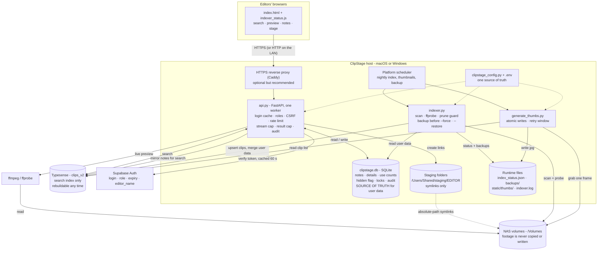

# ClipStage

ClipStage is a self-hosted browser application for finding video footage across newsroom NAS
volumes. Editors search the indexed archive, preview clips, add notes and details, and stage the
clips they need into their own folder for editing. Administrators run and monitor the indexer from
the web interface. Footage is never copied or modified: ClipStage only reads the NAS and creates
symlinks.

> **Fastest way to install (macOS or Windows): [`INSTALL-QUICKSTART.md`](INSTALL-QUICKSTART.md)** - one
> command per machine (`install-mac-host.sh`, `install-win-host.ps1`, and the matching editor installers).
>
> **This file describes the tool and day-to-day operations.** For step-by-step installation:
>
> | You have... | Read |
> | --- | --- |
> | An existing Mac installation | [`README-RUNNING-MACHINE.md`](README-RUNNING-MACHINE.md) - operate, back up, and troubleshoot |
> | A new Mac installation | [`README-FRESH-INSTALL.md`](README-FRESH-INSTALL.md) - step-by-step setup |
> | A Windows host needing HTTPS or scheduled-task help | See [Windows HTTPS and scheduled tasks](#windows-https-and-scheduled-tasks) below |

## Install and sign in

The **host** runs the API, search index and scheduled indexing. Each **editor computer** opens the
web app and stages clips. Run the matching installer from the ClipStage project folder:

| Machine | macOS | Windows |
| --- | --- | --- |
| Host | `bash install-mac-host.sh` | `powershell -ExecutionPolicy Bypass -File .\install-win-host.ps1` |
| Editor | `bash install-mac-editor.sh --host <host-ip>` | Run the one-line command printed by the Windows host installer |

After host setup, add user accounts in Supabase, run `supabase_profiles_setup.sql` in the Supabase
SQL editor, and assign each user a role and expiry date. The host installer copies the SQL and
opens the editor to help with this step. Then open `http://<host-ip>:8000` and sign in.

The default search engine is Typesense on macOS and SQLite FTS5 on Windows. Windows SQLite needs
no WSL or separate search service. Keep the host and editor computers on the same platform; mixed
Mac/Windows setups are not supported by the installers.

## Day-to-day command reference

Run commands from the ClipStage project folder. On Windows, the installer normally places it at
`C:\ClipStage`; on macOS, it is normally `~/Documents/ClipStage`.

| Task | macOS | Windows PowerShell |
| --- | --- | --- |
| Check services | `./clipstage.sh status` | `.\clipstage.ps1 status` |
| Start / stop API | `./clipstage.sh start` / `stop` | `.\clipstage.ps1 start` / `stop` |
| Stop all services | — | `.\clipstage.ps1 stop-all` |
| Restart | `./clipstage.sh restart` | `.\clipstage.ps1 restart` |
| Follow index / API logs | `./clipstage.sh logs` / `logs api` | `.\clipstage.ps1 logs` / `logs api` |
| Follow Typesense log | — | `.\clipstage.ps1 logs typesense` |
| Index all volumes | `./clipstage.sh index` | `.\clipstage.ps1 index` |
| Index selected volumes | `./clipstage.sh index PLAYOUT EDIT2` | `.\clipstage.ps1 index PLAYOUT EDIT2` |
| Stop an active index safely | `./clipstage.sh stop-index` | `.\clipstage.ps1 stop-index` |
| Generate thumbnails | `./clipstage.sh thumbs 5000` | `.\clipstage.ps1 thumbs 5000` |
| Back up the database | `./clipstage.sh backup` | `.\clipstage.ps1 backup` |
| Open the app | `./clipstage.sh open` | `.\clipstage.ps1 open` |
| Rebuild the Windows editor kit | — | `.\clipstage.ps1 editor-kit` |

The host installer registers background jobs. On Windows these are Task Scheduler tasks; see the
Windows section below. The nightly job indexes, generates thumbnails and backs up `clipstage.db`.

On Windows, try commands without an execution-policy bypass first. If PowerShell says scripts are
disabled, either run a command as
`powershell -ExecutionPolicy Bypass -File .\clipstage.ps1 status`, or allow locally created scripts
for your user with `Set-ExecutionPolicy -Scope CurrentUser RemoteSigned`. The scheduled ClipStage
tasks already set their own execution policy.

## Features

- **Word-by-word search** across filename, folder, volume, category, notes and editor details
  (tags, reporter, location, description). Any word order; the last word may be a prefix.
- **Filters and sorting:** by volume, by file size; duration, date and size shown per clip. Very
  large result sets are capped (default 2,000) and the UI says so.
- **Stop a running index:** admins get a **Stop** button on the progress bar. It ends the run safely
  (nothing is pruned or deleted) and the next run carries on.
- **Preview:** live FFmpeg transcode, five-minute limit, at most three previews at once
  (configurable).
- **Thumbnails:** one JPEG per clip, generated after the nightly index.
- **Notes and details:** save a note on one clip or on many, and details on one clip. Stored in a
  local database, so a re-index can never lose them.
- **Staging:** symlinks into the editor's folder. Two different clips with the same filename are
  both kept (the second gets a suffix). Only indexed clips can be staged.
- **Warnings:** a clip already staged by another editor; someone else has the clip's notes open.
- **Hide / restore:** an admin can hide a clip from search. It stays hidden after re-indexing and
  can be restored.
- **Audit trail:** logins, staging, notes, hides/restores and indexer runs (admin-readable).
- **Indexer control:** progress, last-run history, and a volume picker (tick one or several volumes) for quick partial re-indexes, and results shown 250 or 500 per page.
- **Safety guards:** the indexer refuses to prune a volume that looks empty or half-mounted, and
  snapshots the index before any rebuild.

## Architecture



The same diagram is in `architecture.mermaid`.

| Piece | Role | Failure behaviour |
| --- | --- | --- |
| `index.html`, `indexer_status.js` | Single-page UI, served by the API | Everything that comes from the NAS is HTML-escaped before display |
| `api.py` | Login, search, notes/details, locks, staging, preview, admin | Starts even when Typesense is down; search then errors until it is back |
| Typesense (`clips_v2`) | Search index only | Rebuildable from the NAS at any time |
| `clipstage.db` (SQLite) | Notes, details, use counts, hidden flags, locks, audit log | **Back this file up** - it cannot be rebuilt |
| Supabase | Who may log in, their role, expiry date and optional editor binding | Login unavailable if unreachable; signed-in users keep working for up to 60 s |
| `indexer.py` | Scans NAS volumes into Typesense | Refuses to prune a suspicious volume; snapshots before `--force` |
| `generate_thumbs.py` | One JPEG per clip | Failures are retried after 7 days; an unmounted volume is never recorded as a failure |
| `clipstage_config.py` | Volumes, extensions, clip-ID hash, collection name, paths | Single source of truth shared by all three programs |
| NAS volumes | The only copy of the footage | Never written to by ClipStage |

## Components

| File | Purpose |
| --- | --- |
| `api.py` | FastAPI application |
| `indexer.py` | Scans volumes into Typesense; prune guard, backups, restore |
| `generate_thumbs.py` | Thumbnail generator (reads the clip list from the index) |
| `clipstage_config.py` | Shared configuration |
| `store.py` | SQLite store for user data |
| `index.html`, `indexer_status.js` | Browser UI (served from `static/` **or** next to `api.py`, whichever is newer) |
| `migrate_to_v2.py` | One-time migration from an older Typesense collection |
| `editors.json` | Editor names for the staging dropdown (create from `editors.sample.json`) |
| `clipstage_env.sh` | Shared shell setup: safe `.env` loader, Python/Typesense discovery, alerts |
| `clipstage_run.sh` | Runs any Python tool with `.env` loaded: `./clipstage_run.sh indexer.py --dry` |
| `start_clipstage.sh`, `manual_index.sh`, `nightly_index.sh`, `install_nightly.sh`, `com.clipstage.indexer.plist` | Launching and scheduling on macOS |
| `Caddyfile.sample` | HTTPS reverse-proxy example |
| `supabase_profiles_setup.sql` | Profile table and policy for Supabase |
| `.env.sample` | Every setting, documented |
| `tests/` | Automated tests (Python + browser smoke test) |
| Runtime files (Git-ignored) | `.env`, `clipstage.db`, `index_status.json`, `index_dircache.json`, `indexer.log`, `launchd.log`, `backups/`, `static/thumbs/` |

## Where the data lives

| Data | Source of truth | Backup needed? |
| --- | --- | --- |
| Footage: names, sizes, dates | NAS - re-read by the indexer | No |
| Search index | Typesense `clips_v2` (Mac) or `clipstage_search.db` (Windows) | No - rebuildable (but `backups/` snapshots speed recovery) |
| Notes, details, use counts, hidden flags, locks, audit log | **`clipstage.db`** | **Yes - copy it nightly** |
| Accounts, roles, expiry dates | Supabase | Yes (project backup / export) |
| Editor names | `editors.json` | Keep a copy |
| Staged symlinks | `/Users/Shared/staging/<EDITOR>/` | No |

Notes and details are written to SQLite first and mirrored into Typesense so they stay searchable.
If Typesense is briefly down when someone saves a note, the next index run re-syncs the difference.

## Accounts and roles

Supabase Auth owns passwords. The table `public.clipstage_profiles` gives each login a role and an
expiry date, and optionally binds it to one editor name.

- **editor** - search, preview, stage, notes, details.
- **admin** - everything an editor can do, plus hide/restore clips, start index runs and read the
  audit log.
- A profile with `editor_name` can only use that editor's staging folder. A profile without it is a
  shared login that can act as any name in `editors.json`; every action is still audited against the
  real login.
- A profile past its `valid_through` date cannot log in. A revoked or expired account stops working
  within 60 seconds.

## Search rules

Every word must match, in any order, in filename / folder / volume / category / notes / editor
details. Only the **last** word may be a partial prefix (`first laun` finds `Launch_First`;
`fir launch` does not). Names are split on `_ - . ( ) [ ] +`, so `AMMA_UNAVAGAM-LAUNCH.mxf` is
searchable by any of its words. Set `CLIPSTAGE_NUM_TYPOS=1` to tolerate one typo per word (Typesense engine only).

### Search engines: one code base, Mac and Windows

`SEARCH_BACKEND` in `.env` picks the engine; the API, the indexer and the web page are identical:

| `SEARCH_BACKEND` | Default on | Needs | Notes |
| --- | --- | --- | --- |
| `typesense` | Mac / Linux | the Typesense server | as before |
| `sqlite` | Windows | nothing (SQLite FTS5 is built into Python) | no WSL, no extra service; index file `clipstage_search.db` (`CLIPSTAGE_SEARCH_DB` to move it) |

Both give the same matching (all words, any order, last word prefix, one field), the same filters, facets, sort
orders, highlighting, notes and drag-and-drop. Differences: SQLite has no typo tolerance (`CLIPSTAGE_NUM_TYPOS` is
ignored; the default is 0 anyway). The search index is always rebuildable: switching engine = run the indexer once;
notes, use counts and hidden flags live in `clipstage.db` and are carried over.

## Indexing

The Python tools do **not** read `.env` themselves. Run them through `./clipstage_run.sh` (it loads
`.env` first); running `python3 indexer.py` directly fails with `TYPESENSE_KEY environment variable
is required`.

```sh
./clipstage_run.sh indexer.py                  # incremental scan (unchanged folders are skipped)
./clipstage_run.sh indexer.py --dry            # count only, write nothing
./clipstage_run.sh indexer.py --prune          # also remove entries whose file is gone (guarded)
./clipstage_run.sh indexer.py --only PLAYOUT   # one volume
./clipstage_run.sh indexer.py --only EDIT2,PLAYOUT   # a few volumes (comma list)
./clipstage_run.sh indexer.py --full           # ignore the folder cache
./clipstage_run.sh indexer.py --reprobe        # retry duration probing for blank clips
./clipstage_run.sh indexer.py --force          # recreate the collection (snapshot first)
./clipstage_run.sh indexer.py --restore backups/clips_20261001_170000.jsonl
./clipstage_run.sh indexer.py --prune --allow-mass-prune      # override the prune safety limit
```

The nightly job runs `--prune`, then generates up to 5,000 new thumbnails. A full folder rescan is
forced every 7 days per volume.

**Safety built in**

- `--force` first writes `backups/clips_<time>.jsonl` (the newest five are kept). If the snapshot
  cannot be written, the rebuild is aborted before anything is deleted.
- `--prune` is decided **per volume**. If more than `CLIPSTAGE_PRUNE_MAX_PERCENT` (default 5 %) of a
  volume's clips - and more than 50 - look missing, or the scan saw nothing at all, that volume is
  **not** pruned. A warning appears in the UI status line and the nightly job raises an alert.
  Volumes whose scan had read errors are never pruned.
- `--restore` puts a snapshot back and then re-applies the live notes, usage counts and hidden flags
  from SQLite, so a restore can never roll user data back.
- A clip's ID is a hash of its path. Moving or renaming a file creates a new clip; notes stay with
  the old ID.

## Staging

Clips are staged as absolute-path symlinks under `<staging path>/<EDITOR>/`. Editors reach that
folder through the configured SMB share (the Finder action uses `CLIPSTAGE_SMB_HOST`). Symlinks only
work if the SMB server exposes them and the editor's Mac has the NAS volumes mounted under the same
names - **verify this once on a real editor machine.**

## Windows HTTPS and scheduled tasks

The Windows installer configures the ClipStage API and its scheduled jobs, but does not install or
configure Caddy. HTTPS is recommended when editors access the host over a network. The steps below
use an administrator PowerShell window on the Windows host. Replace `192.168.1.50` with the host's
actual IP address; a local DNS name can be used instead.

### Configure Caddy as an HTTPS reverse proxy

1. Install Caddy with `winget install CaddyServer.Caddy`. Open a new PowerShell window and check
   the installation with `caddy version`.
2. Save the following as `C:\ClipStage\Caddyfile` (the file has no extension):

   ```caddy
   192.168.1.50 {
       tls internal
       encode gzip
       reverse_proxy 127.0.0.1:8000 {
           flush_interval -1
       }
   }
   ```

   `flush_interval -1` avoids buffering video previews. If port 443 is unavailable, use
   `192.168.1.50:8443` as the site address and use that port in the remaining steps.
3. Trust Caddy's local certificate authority and allow the HTTPS port through the Windows
   firewall:

   ```powershell
   caddy trust
   New-NetFirewallRule -DisplayName "Caddy HTTPS" -Direction Inbound -Protocol TCP -LocalPort 443 -Action Allow -Profile Private,Domain
   ```

   For port 8443, change `-LocalPort 443` to `-LocalPort 8443`.
4. Start Caddy for a test with `caddy run --config C:\ClipStage\Caddyfile`. From an editor
   computer, visit `https://192.168.1.50`. For a private/internal certificate to be trusted without
   browser warnings, install the host's
   `C:\Users\<user>\AppData\Roaming\Caddy\pki\authorities\local\root.crt` certificate on each
   editor computer. On Windows, install it for the current user under **Trusted Root Certification
   Authorities**. On macOS, add it to the login keychain and set it to **Always Trust**. Firefox
   may need the certificate imported separately.
5. Confirm the API responds on the host before switching to HTTPS-only access:

   ```powershell
   curl.exe -s http://127.0.0.1:8000/health
   ```

   The response should be `{"status":"ok"}`. Then edit `C:\ClipStage\.env` (change existing
   entries rather than adding duplicates) and set:

   ```dotenv
   CLIPSTAGE_BIND_HOST=127.0.0.1
   CLIPSTAGE_COOKIE_SECURE=1
   ```

   Restart the API with `Stop-ScheduledTask -TaskName 'ClipStage-API'` followed by
   `Start-ScheduledTask -TaskName 'ClipStage-API'`. Editors should use the HTTPS address; direct
   access to `http://<host>:8000` will no longer work from other computers.
6. To start Caddy automatically when the installing user signs in, register a scheduled task from
   administrator PowerShell:

   ```powershell
   $a = New-ScheduledTaskAction -Execute (Get-Command caddy).Source -Argument 'run --config C:\ClipStage\Caddyfile' -WorkingDirectory 'C:\ClipStage'
   $t = New-ScheduledTaskTrigger -AtLogOn
   $s = New-ScheduledTaskSettingsSet -AllowStartIfOnBatteries -DontStopIfGoingOnBatteries -ExecutionTimeLimit ([TimeSpan]::Zero) -RestartCount 999 -RestartInterval (New-TimeSpan -Minutes 1)
   Register-ScheduledTask -TaskName 'ClipStage-Caddy' -Action $a -Trigger $t -Settings $s -RunLevel Highest -Force
   ```

### Check Windows background tasks

The Windows installer registers these tasks:

| Task | Purpose |
| --- | --- |
| `ClipStage-API` | Starts the API at sign-in and retries if it stops |
| `ClipStage-Nightly` | Runs indexing, thumbnails and database backup daily |
| `ClipStage-MountWatch` | Checks NAS mounts every five minutes; only created when `CLIPSTAGE_NAS_HOST` is set |
| `ClipStage-Typesense` | Starts Typesense only when that search engine is selected |
| `ClipStage-Caddy` | Optional task created by the HTTPS instructions above |

There is no separate Windows indexer task; `ClipStage-Nightly` runs the indexer. Check task state
and the nightly task's last and next run with:

```powershell
Get-ScheduledTask -TaskName 'ClipStage-*' | Select-Object TaskName, State
Get-ScheduledTaskInfo -TaskName 'ClipStage-Nightly' | Select-Object LastRunTime, LastTaskResult, NextRunTime
Get-ScheduledTaskInfo -TaskName 'ClipStage-MountWatch' | Select-Object LastRunTime, LastTaskResult, NextRunTime
```

`Ready` or `Running` is normal; `Disabled` means the task will not run. A `LastTaskResult` of `0`
means success; `267011` means the task has not run yet. Start the nightly job manually to test it:

```powershell
Start-ScheduledTask -TaskName 'ClipStage-Nightly'
```

You can also inspect tasks in Task Scheduler (`taskschd.msc`). Logs are in `C:\ClipStage`, including
`api.log` and `indexer.log`. The installer's tasks run while the installing user is signed in; after
a reboot, sign in for the tasks to start. If a ClipStage task is missing, re-run
`install-win-host.ps1`; the installer safely registers the tasks again.

## Additional maintenance commands

Run these from the project folder when needed:

```sh
./clipstage_run.sh snapshot_index.py
./clipstage_run.sh indexer.py --restore backups/clips_<timestamp>.jsonl
./clipstage_run.sh indexer.py --reprobe
./clipstage_run.sh indexer.py --prune
./clipstage_run.sh generate_thumbs.py --limit 5000
./clipstage_run.sh generate_thumbs.py --retry-failed
./clipstage_run.sh backup_db.py
python envtool.py get KEY
python envtool.py set KEY VALUE
```

The `clipstage_run.sh` examples are for macOS/Linux. On Windows, use the matching
`.\clipstage.ps1` commands in the table above. For a preview-only uninstall, use
`bash uninstall_clipstage.sh --dry-run` on macOS or
`powershell -ExecutionPolicy Bypass -File .\uninstall_clipstage.ps1 -DryRun` on Windows. Remove
ClipStage only after reviewing the uninstaller's actions.

## Configuration

All settings live in `.env` (copy `.env.sample`). A variable already set in the shell wins over
`.env`.

| Variable | Default | Purpose |
| --- | --- | --- |
| `SEARCH_BACKEND` | `typesense` (Mac/Linux), `sqlite` (Windows) | Search engine; see *Search engines* above |
| `CLIPSTAGE_SEARCH_DB` | `clipstage_search.db` | SQLite engine only: index file location |
| `TYPESENSE_HOST` / `TYPESENSE_PORT` | `localhost` / `8108` | Typesense address (Typesense engine only) |
| `TYPESENSE_KEY` | **required** | Typesense API key - generate a new random one |
| `SUPABASE_URL`, `SUPABASE_ANON_KEY` | **required** | Supabase login; never the service-role key |
| `CLIPSTAGE_COLLECTION` | `clips_v2` | Search collection name |
| `CLIPSTAGE_VOLUMES_ROOT` | `/Volumes` | Where NAS volumes are mounted |
| `CLIPSTAGE_SCAN_VOLUMES` | `EDIT,EDIT2,INGEST,PLAYOUT,DIGITAL,SHARE FOLDER,TRANSCODER` | Volumes to index, in order |
| `CLIPSTAGE_STAGING_PATH` | `/Users/Shared/staging` | Root of the per-editor staging folders |
| `CLIPSTAGE_THUMB_DIR` | `static/thumbs` | Thumbnail output directory |
| `CLIPSTAGE_DB` | `./clipstage.db` | SQLite file (notes, usage, locks, audit) |
| `CLIPSTAGE_API_PORT` | `8000` | API port |
| `CLIPSTAGE_BIND_HOST` | `127.0.0.1` | Interface the API listens on |
| `CLIPSTAGE_FORWARDED_ALLOW_IPS` | `127.0.0.1` | Proxies trusted to set `X-Forwarded-*` |
| `CLIPSTAGE_COOKIE_SECURE` | `0` | `1` marks the login cookie Secure (use with HTTPS) |
| `CLIPSTAGE_ALLOWED_ORIGINS` | empty | CORS is **off** unless origins are listed |
| `CLIPSTAGE_DOCS` | off | `1` exposes `/docs` |
| `CLIPSTAGE_MAX_RESULTS` | `2000` | Most clips one search returns |
| `CLIPSTAGE_RANK_BUCKETS` | `5` | Best-match ranking: relevance bands; same band → most staged first, then newest (0 = exact ties only) |
| `CLIPSTAGE_MAX_STREAMS` | `3` | Simultaneous previews |
| `CLIPSTAGE_NUM_TYPOS` | `0` | Typo tolerance per word |
| `CLIPSTAGE_SCAN_THREADS`, `CLIPSTAGE_PROBE_THREADS` | `16`, `8` | Indexer parallelism |
| `CLIPSTAGE_PRUNE_MAX_PERCENT` | `5` | Prune refusal threshold per volume |
| `CLIPSTAGE_THUMBS`, `CLIPSTAGE_THUMBS_LIMIT` | `1`, `5000` | Nightly thumbnails on/off, and per-night cap |
| `CLIPSTAGE_THUMB_WORKERS`, `CLIPSTAGE_THUMB_RETRY_DAYS`, `CLIPSTAGE_THUMB_TIMEOUT` | `4`, `7`, `30` | Thumbnail parallelism, retry window, ffmpeg timeout (s) |
| `CLIPSTAGE_ALERT_WEBHOOK` | empty | Slack/Teams/Discord-style webhook for failure alerts |
| `CLIPSTAGE_SMB_HOST` | empty | SMB host used by the Finder action |
| `CLIPSTAGE_PYTHON`, `TYPESENSE_BIN`, `TYPESENSE_DATA_DIR`, `TYPESENSE_LISTEN_ADDRESS` | auto | Overrides for the launch scripts |

## API reference

Interactive documentation at `/docs` when `CLIPSTAGE_DOCS=1`. Every state-changing request must
carry the header `X-ClipStage-CSRF: 1` (the UI does this automatically).

| Method | Path | Who | Purpose |
| --- | --- | --- | --- |
| `GET` | `/` | public | Web interface |
| `GET` | `/health` | public | `{"status":"ok"}` only |
| `GET` | `/static/indexer_status.js` | public | Indexer status widget |
| `POST` | `/auth/login`, `/auth/logout` | public | Sign in / out (login is rate-limited) |
| `GET` | `/config`, `/editors` | login | UI settings; editor names |
| `GET` | `/search?q=` | login | `volume`, `sort`, `page`, `per_page`, `all`; returns `total`, `truncated` |
| `GET` | `/facets/volumes`, `/volumes` | login | Volumes |
| `GET` | `/thumb/{uid}`, `/stream/{uid}` | login | Thumbnail; transcoded preview (429 when all slots are busy) |
| `POST` | `/stage` | login | Stage clip paths (indexed clips only) |
| `GET` / `DELETE` | `/stage/{editor}` | login | List / clear a staging folder |
| `GET` | `/staging/view/{editor}` | login | Staging-folder listing |
| `POST` | `/check-conflicts` | login | Which clips another editor already staged |
| `PATCH` | `/clip/{uid}/notes` | login | Update a note (versioned) |
| `POST` | `/meta/{uid}` | login | Tags, reporter, location, description |
| `POST` | `/clips/bulk-notes` | login | Same note for clip **IDs** |
| `POST` / `DELETE` | `/lock/{uid}` | login | Advisory edit lock (10 minutes) |
| `DELETE` | `/clip/{uid}` | **admin** | Hide a clip from search (reversible) |
| `GET` | `/admin/hidden` | **admin** | List hidden clips |
| `POST` | `/admin/restore/{uid}` | **admin** | Un-hide a clip |
| `GET` | `/admin/audit` | **admin** | Newest audit events |
| `GET` | `/admin/health` | **admin** | Version, collection, document count, mounted volumes |
| `GET` | `/admin/index-status`, `/admin/indexable-volumes` | login | Indexer status |
| `POST` | `/admin/run-indexer` | **admin** | Start a pruned scan (`?volume=` to scope) |

## Security model

- Every route except the login page, `/health`, login/logout and the status script needs a valid
  Supabase session, and the account's profile is re-checked at least every 60 seconds.
- CSRF header on every write; CORS closed by default; login rate-limit; security headers; API docs
  off by default; `/health` reveals nothing about the deployment.
- Staging accepts only clips that are in the index, with editor names validated against path
  tricks; filters and IDs are validated before they reach Typesense or SQLite.
- Everything that originates on the NAS (file names, folders, paths) is HTML-escaped before it is
  shown.
- Typesense listens on `127.0.0.1` when ClipStage starts it. Put an HTTPS proxy in front of the API
  for anything beyond one computer - otherwise passwords and the login cookie cross the LAN in clear
  text. **Do not expose ClipStage to the public internet.**
- `.env` is read by a parser that never executes its contents.

## Testing

```sh
python3 -m pip install -r requirements-dev.txt
python3 -m pytest -q                     # fakes Typesense, Supabase and the NAS; uses real ffmpeg for thumbnails

# optional browser-level check (needs Node): runs the real UI in jsdom with a stubbed network
cd tests && npm install && cd .. && node tests/ui_smoke.mjs
```

The Python tests cover: authorization and CSRF, rate limiting, search, staging safety, SQLite user
data, hide/restore, locks, stream limits, the prune guard, backup/restore, thumbnail generation and
retry rules, the shared configuration, the `.env` loader, script syntax, and packaging hygiene. The
browser test checks that bulk-notes and hide send clip IDs, that hostile file names stay inert, that
every write carries the CSRF header, and that the Sync button honours the volume picker.

They do **not** exercise a real Typesense, a real Supabase, a real NAS, SMB symlink behaviour or a
real browser. See the "Verify" section of either install guide for the one-time live checks.

## Known limitations

- Search ranking is Typesense's; test it once against your real index.
- A clip's ID is a hash of its path: moving or renaming a folder creates new clips without their
  notes.
- Previews are live transcodes: no seeking. Prebuilt proxies would fix this.
- No automatic token refresh: editors sign in again when the Supabase token expires (default one
  hour; raise it in the Supabase Auth settings if editors are interrupted).
- Edit locks, login rate-limits and the login cache live in memory, so run a **single** uvicorn
  worker (the launch script does).
- The UI builds pages from template strings; output is escaped, but a component rewrite would be
  safer long-term.
- Staging and opening the shared staging folder depend on the host operating system and its
  configured file-sharing setup. Follow the matching host and editor installation instructions.
